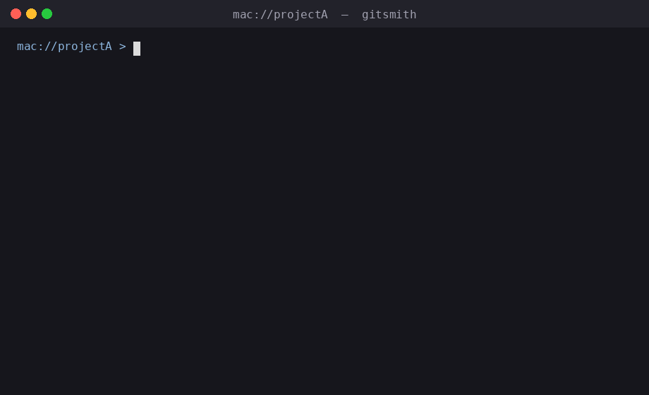
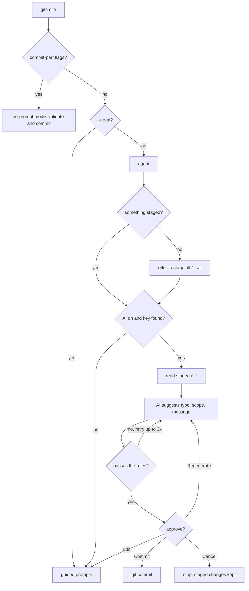
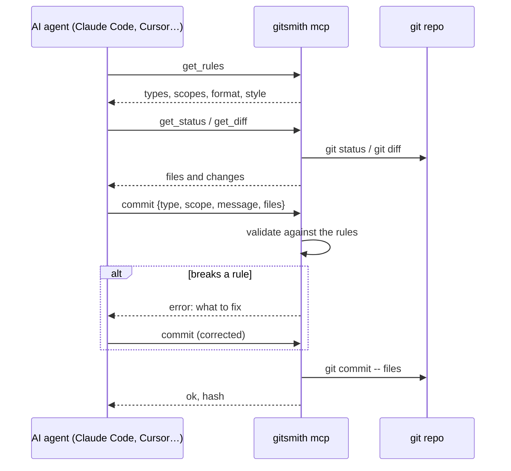

# gitsmith

**The commit agent that follows your team's rules.** Run `gitsmith`: it reads your staged changes, writes a Conventional Commit that matches your `.commitconfig.json`, and commits once you approve.

[](https://www.npmjs.com/package/gitsmith)
[](https://www.npmjs.com/package/gitsmith)
[](https://github.com/chapeee/gitsmith/blob/master/LICENSE)
[](https://nodejs.org/)
[](https://github.com/chapeee/gitsmith/pulls)
[](https://github.com/chapeee/gitsmith/issues)



## Contents

- [Overview](#overview)
- [Features](#features)
- [Install](#install)
- [Quick start](#quick-start)
- [The agent (default)](#the-agent-default)
- [Modes at a glance](#modes-at-a-glance)
- [Commands](#commands)
- [Agentic workflow: AI agents, scripts and CI](#agentic-workflow-ai-agents-scripts-and-ci)
- [Configuration](#configuration)
- [AI setup](#ai-setup)
- [Privacy](#privacy)
- [Architecture](#architecture)
- [Development](#development)
- [Roadmap](#roadmap)
- [AI contributors](#ai-contributors)
- [Open source](#open-source)

## Overview

Every team has a commit format, and almost nobody follows it consistently. People forget the scope, AI coding agents ignore the format completely, and the history turns into "wip" and "fix stuff".

gitsmith fixes this from both sides:

- **It writes the commit for you.** `gitsmith` on its own is an agent. It looks at what you staged, writes a message in your format, checks it against your rules and commits when you say so.
- **It enforces the format for everyone else.** A `commit-msg` hook rejects bad messages from any source: people, IDEs or AI agents running plain `git commit`. The error says exactly what to fix.
- **It's a tool for AI agents.** Claude Code, Cursor and other agents connect over MCP and get typed tools: rules, status, diff, check and commit. The agent writes the message, because it knows what it changed, and gitsmith guarantees it follows your rules. Agents without MCP use the no-prompt CLI with JSON output.
- **Rules are shareable.** A team publishes one rules file; every repo `extends` it and overrides only what's different.

The rules live in `.commitconfig.json`. Install gitsmith once, add a config to each repo (or extend your team's), and every commit comes out consistent.

## Features

**The agent**
- `gitsmith` reads the staged diff and writes the commit with AI (a free NVIDIA model)
- Every suggestion is checked against your rules. If one breaks them, the agent retries with the violations as feedback
- Commit, Edit, Regenerate or Cancel before anything is written
- Offers to stage everything when nothing is staged (`--all` does it straight away)
- Falls back to guided prompts when there is no API key or AI is off
- `--yes` commits without asking, for scheduled jobs and automation

**Rules and enforcement**
- Your format, types, scopes, ticket prefix and length limit, all in `.commitconfig.json`
- Strict scopes: only listed scopes are allowed (the default for new configs)
- Message style: summary starts lowercase, no trailing period (acronyms like `API` are fine)
- `commit-msg` hook that checks every commit, including plain `git commit`
- `gitsmith check` validates any message without committing

**Built for AI agents and scripts**
- MCP server (`gitsmith mcp`) with `get_rules`, `get_status`, `get_diff`, `check_message` and `commit` tools
- `gitsmith agents --mcp` registers it in `.mcp.json`, so Claude Code picks it up for the project
- Split one change into several commits: `commit` with `files` (MCP) or `--files` (CLI)
- No-prompt mode: `gitsmith -t feat -s api -m "add retry logic"`
- `--json` output and exit code 1 on errors, so tools can react and retry
- `gitsmith rules --json` tells an agent what is allowed
- `gitsmith agents` writes the rules into `AGENTS.md`, `CLAUDE.md` or `.cursorrules`
- `--co-author` and `--author` for crediting AI and pair work
- Never hangs without a terminal: it exits with a hint instead

**Shareable rules**
- `"extends"`: built-in presets (`gitsmith:conventional`, `gitsmith:angular`, `gitsmith:minimal`), files, URLs and npm packages
- Override any rule, or add to an inherited list with `"scopes+": [...]`
- `gitsmith rules --resolved` shows which file set each rule; `gitsmith rules export` writes a file to share
- Remote rules are cached, can be pinned by sha256, and keep working offline
- A personal `.commitconfig.local.json` can change your AI settings but never loosen team rules

**Safety**
- Must be inside a git repo, with something staged
- Config validated with clear errors
- Config found by walking up from the current folder, so it works from any subfolder

## Install

```bash
npm install -g gitsmith
```

Requires Node.js 20 or newer. Check it works:

```bash
gitsmith --help
```

### Latest version from GitHub

To get the newest code from `master` before it's released on npm, install the GitHub tarball:

```bash
npm install -g https://github.com/chapeee/gitsmith/tarball/master
```

Use the tarball URL rather than `github:chapeee/gitsmith`. On Windows, npm 11 can turn a `github:` global install into a link to a temporary clone that it then deletes, which leaves `gitsmith` broken. If that already happened, run `npm uninstall -g gitsmith` and install the tarball.

Until the next npm release, register the MCP server with your installed `gitsmith` instead of `npx` (which fetches the npm release):

```bash
claude mcp add gitsmith --scope user -- gitsmith mcp
```

## Quick start

```bash
cd your-project
gitsmith init          # creates .commitconfig.json
gitsmith key:set       # paste a free NVIDIA API key (build.nvidia.com)
git add .
gitsmith               # the agent writes the commit; approve it
```

No API key? `gitsmith` still works: it switches to guided prompts that walk you through type, scope and message.

## The agent (default)

Running `gitsmith` with no arguments starts the agent:

```text
$ gitsmith
gitsmith agent: 2 staged file(s)
  src/auth/login.js
  test/login.test.js

Proposed commit: fix(auth): redirect to the dashboard after login
Why: changes the post-login redirect target and adds a test for it

? What next? ›
❯ Commit
  Edit before committing
  Regenerate
  Cancel
```

What it does, step by step:

1. Checks you are in a git repo and loads `.commitconfig.json`.
2. If nothing is staged, lists your changed files and offers to stage them all.
3. Reads the staged diff. Lock files and minified files are left out, and very large diffs are cut short.
4. Asks the AI for a commit that follows your types, scopes and format.
5. Validates the suggestion against your rules. If it breaks one (an unknown scope, a capital letter, a trailing period), the agent asks again with the violations as feedback, up to 3 times.
6. Shows the proposed commit and why it was chosen, then waits for your choice:
   - **Commit**: commits it.
   - **Edit before committing**: opens the guided prompts pre-filled with the suggestion.
   - **Regenerate**: asks the AI for another suggestion.
   - **Cancel**: leaves your staged changes as they are.

Useful options:

```bash
gitsmith --all                          # stage everything first if nothing is staged
gitsmith --hint "fix the login redirect"  # tell the agent what the change is for
gitsmith --yes --all                    # commit without asking (automation)
gitsmith --co-author "Claude <noreply@anthropic.com>"
```

## Modes at a glance

| You run | Mode | Use it for |
| --- | --- | --- |
| `gitsmith` | **Agent** (default) | Everyday commits: AI writes, you approve |
| `gitsmith --yes` | Agent, auto-approve | Scheduled jobs, automation |
| `gitsmith commit` | Guided prompts | Pick type, scope and message step by step, with optional AI help |
| `gitsmith --no-ai` | Guided prompts, no AI | Fully manual |
| `gitsmith -t <type> -s <scope> -m "<msg>"` | No-prompt | AI agents, scripts, CI |

## Commands

### Committing

| Command | What it does |
| --- | --- |
| `gitsmith` / `gitsmith agent` | Start the agent |
| `gitsmith commit` | Guided prompts |
| `gitsmith -t <type> -m "<msg>" [...]` | Commit without prompts |

Options for committing:

| Option | Meaning |
| --- | --- |
| `-a, --all` | Agent: stage all changes when nothing is staged |
| `-y, --yes` | Agent: commit without asking |
| `--hint <text>` | Agent: tell it what the change is for |
| `--no-ai` | Skip the agent and use the guided prompts |
| `--ai` | Guided prompts: ask for AI help |
| `-t, --type <type>` | Commit type; must be in `types` |
| `-s, --scope <scope>` | Scope; required when `scopes` is set |
| `-m, --message <msg>` | Summary |
| `--ticket <id>` | Ticket id; `ticketPrefix` is added if missing |
| `-b, --breaking` | Breaking change; adds `!` |
| `--body <text>` | Commit body |
| `--co-author <person>` | Adds `Co-Authored-By: <person>`; repeatable; format `"Name <email>"` |
| `--author <person>` | Sets the commit author; you stay the committer |
| `--files <paths...>` | Commit only these paths (new files included); other staged changes stay staged |
| `--dry-run` | Validate and show the header; commit nothing |
| `--json` | Machine-readable output |

### Rules and enforcement

| Command | What it does |
| --- | --- |
| `gitsmith check "<message>"` | Check a message against the rules (exit 1 if invalid) |
| `gitsmith check --file <path>` | Check a message file; used by the hook |
| `gitsmith check --stdin` | Check a message from stdin |
| `gitsmith rules [--json]` | Print the commit rules |
| `gitsmith rules --resolved [--json]` | Show the `extends` chain and which file set each rule |
| `gitsmith rules export [-o <file>]` | Write the resolved rules as one shareable JSON file |
| `gitsmith hook install [--force]` | Install the `commit-msg` hook |
| `gitsmith hook uninstall` | Remove the hook (only if gitsmith wrote it) |

### AI agents

| Command | What it does |
| --- | --- |
| `gitsmith mcp` | Run the MCP server over stdio (started by MCP clients, not by hand) |
| `gitsmith agents [--file <paths...>]` | Write the rules into agent instruction files (default `AGENTS.md`) |
| `gitsmith agents --mcp` | Also register the gitsmith MCP server in the project's `.mcp.json` |
| `gitsmith agents --force` | Replace a gitsmith section (or `.mcp.json` entry) you edited by hand |
| `gitsmith agents --print` | Print the gitsmith section instead of writing it |

### Setup and keys

| Command | What it does |
| --- | --- |
| `gitsmith init [--force]` | Create `.commitconfig.json` with the default rules |
| `gitsmith init --from <rules>` | Create a config that extends shared rules (preset, file, URL or package) |
| `gitsmith key:set [key]` | Save your NVIDIA API key; prompts if no key is given |
| `gitsmith key:show` | Show the saved key, masked |
| `gitsmith key:status` | Show the provider, the key source and when it was saved |
| `gitsmith key:remove` | Remove the saved key (`key:reset` is an alias) |

## Agentic workflow: AI agents, scripts and CI

AI coding agents (Claude Code, Cursor, Copilot, Codex and others) can't answer interactive prompts, so they usually fall back to plain `git commit` and ignore your format. gitsmith gives them a proper path, and blocks them when they go around it.

The split of work is simple: **the agent writes the message**, because it made the change and knows why; **gitsmith owns the rules**, checking, formatting and committing, and telling the agent exactly what to fix when something is off. No NVIDIA key is needed for this; the NVIDIA model only writes messages for people who run plain `gitsmith`.

### 1. Connect over MCP (recommended)

[MCP](https://modelcontextprotocol.io) is the standard way agents call tools. Register gitsmith for a project:

```bash
gitsmith agents --mcp        # adds gitsmith to .mcp.json and writes AGENTS.md
```

or add it to Claude Code yourself:

```bash
claude mcp add gitsmith -- npx -y gitsmith mcp
```

The agent then gets these tools:

| Tool | What it does |
| --- | --- |
| `get_rules` | The rules: types, scopes (strict or not), format, message style, length, an example, and which file each rule came from |
| `get_status` | Branch; staged, unstaged and untracked files; the last 5 commit subjects |
| `get_diff` | The staged diff, or the diff for given paths |
| `check_message` | Validate a message without committing |
| `commit` | Validate and commit `type`, `scope`, `message` (plus `body`, `breaking`, `ticket`, `co_authors`, `author`, `dry_run`). With `files`, commits exactly those paths, so one change can become several commits |

Every result is structured JSON. A failed call is marked as an error and lists exactly what to fix, so the agent corrects itself and calls again. The server also sends the agent a short workflow guide when it connects.

A typical agent session:

```text
get_rules   → types feat|fix|..., scopes auth|ui|api|db|config (strict), lowercase, no period
get_status  → untracked: src/api/retry.js, src/ui/banner.js
commit      { type: "feat", scope: "api", message: "add retry logic", files: ["src/api/retry.js"] }
            → ok, hash 1a2b3c4
commit      { type: "feat", scope: "ui", message: "Add banner.", files: ["src/ui/banner.js"] }
            → error: message must start with a lowercase letter; must not end with a period
commit      { type: "feat", scope: "ui", message: "add banner", files: ["src/ui/banner.js"] }
            → ok, hash 5d6e7f8
```

### 2. Tell agents the rules

```bash
gitsmith agents                                  # writes a "Commit messages" section into AGENTS.md
gitsmith agents --file AGENTS.md CLAUDE.md .cursorrules
gitsmith rules --json                            # the rules as JSON
```

Your own instructions in `AGENTS.md` are safe. gitsmith only ever touches the text between `<!-- gitsmith:start -->` and `<!-- gitsmith:end -->`:

- **No markers yet:** the section is appended at the end. Your existing text is not changed, not even trailing spaces or line endings.
- **Markers found:** only the text between them is updated. Running it again when nothing changed doesn't rewrite the file, and never creates a second section.
- **You edited inside the section:** gitsmith notices (the start marker stores a fingerprint of what it wrote), keeps your version and tells you. `gitsmith agents --force` replaces it with the current rules; `gitsmith agents --print` shows them so you can merge by hand.
- **Markers in your text or examples:** markers count only as whole lines outside code blocks, so a file that merely mentions them is never cut open.
- **Broken markers** (one of the pair missing, wrong order, two sections): gitsmith explains what's wrong and leaves the file alone.

The best place for your own notes is outside the markers. With `--mcp`, other servers in `.mcp.json` are kept, and so is a gitsmith entry you customized, unless you pass `--force`.

`gitsmith rules --json` returns:

```json
{
  "format": "{type}({scope}): {message}",
  "types": ["feat", "fix", "docs", "chore", "refactor", "test", "style"],
  "scope": { "used": true, "allowed": ["auth", "ui", "api", "db", "config"], "strict": true },
  "ticket": { "used": false, "prefix": "" },
  "breaking": { "used": true, "marker": "!" },
  "messageStyle": "conventional",
  "headerMaxLength": 72,
  "example": "feat(auth): add short summary in imperative mood",
  "commands": {
    "commit": "gitsmith -t feat -s auth -m \"<imperative summary>\"",
    "validate": "gitsmith check \"<header>\"",
    "dryRun": "gitsmith -t feat -s auth -m \"<imperative summary>\" --dry-run --json"
  }
}
```

### 3. Commit without prompts (CLI)

```bash
gitsmith -t feat -s api -m "add retry logic"
gitsmith -t fix -s ui -m "handle empty input" --body "Longer explanation." --breaking
gitsmith -t feat -s api -m "add retry logic" --dry-run --json
```

With `--json` the result is:

```json
{ "ok": true, "hash": "1366e71", "header": "feat(api): add retry logic", "body": "", "author": null, "files": ["src/api.js"], "warnings": [] }
```

or, when something is wrong (exit code 1):

```json
{ "ok": false, "errors": ["type \"feet\" is not allowed. Allowed: feat, fix, docs, chore, refactor, test, style"] }
```

An agent reads the errors, fixes the message and tries again.

### 4. Let gitsmith write the message (automation)

When the environment has an API key, an automated job doesn't need to write the message at all:

```bash
GITSMITH_AI_KEY=... gitsmith --yes --all
```

This stages everything, writes a commit that follows the rules and commits it. Without a terminal and without `--yes`, gitsmith refuses and explains, so it never hangs or reports a success that didn't happen.

### 5. Enforce the format for every commit

```bash
gitsmith hook install
```

This installs a `commit-msg` hook that runs `gitsmith check` on every commit:

```text
$ git commit -m "feat(validation): Add checks."
gitsmith: commit message rejected: "feat(validation): Add checks."
  - scope "validation" is not in the list. Allowed: auth, ui, api, db, config
  - message must start with a lowercase letter: "add checks.".
  - message must not end with a period.
  Expected format: {type}({scope}): {message}
  Example: feat(auth): add short summary in imperative mood
```

How the hook behaves:
- Merge, revert, `fixup!`, `squash!` and `amend!` messages are skipped.
- Git comment lines and the `commit -v` diff are ignored.
- It prefers a project-local gitsmith (`node_modules/.bin`), then a global one. If neither exists, it lets the commit through with a note.
- Without a `.commitconfig.json` it lets commits through.
- It respects `core.hooksPath`, and it won't replace a hook it didn't write unless you pass `--force`.

### 6. Credit AI and pair work

```bash
gitsmith --co-author "Claude <noreply@anthropic.com>"
gitsmith -t feat -s api -m "add retry logic" --co-author "Claude <noreply@anthropic.com>" --co-author "Pat <pat@example.com>"
gitsmith --yes --author "Claude <noreply@anthropic.com>"
```

`--co-author` adds `Co-Authored-By` trailers, which GitHub shows on the commit and counts toward the repo's contributors. `--author` changes the commit author while the configured git user stays the committer.

### Exit codes

| Code | Meaning |
| --- | --- |
| `0` | Success: committed, valid message, or dry run done |
| `1` | Invalid input, a rule broken, git refused the commit, no terminal for a mode that needs one, or (without a terminal) nothing to commit |

## Configuration

gitsmith reads `.commitconfig.json`, searching upward from the current folder. `gitsmith init` writes this default:

```json
{
  "types": ["feat", "fix", "docs", "chore", "refactor", "test", "style"],
  "askScope": true,
  "scopes": ["auth", "ui", "api", "db", "config"],
  "askTicket": false,
  "askBreaking": true,
  "format": "{type}({scope}): {message}",
  "headerMaxLength": 72,
  "strictScopes": true,
  "messageStyle": "conventional",
  "ai": {
    "enabled": true,
    "askByDefault": true
  }
}
```

### Sharing rules with `extends`

Define rules once and reuse them everywhere. A config can extend:

| Source | Example |
| --- | --- |
| Built-in preset | `"gitsmith:conventional"`, `"gitsmith:angular"`, `"gitsmith:minimal"` |
| File | `"./rules/team.json"` (relative to the file that extends it) |
| URL | `"https://raw.githubusercontent.com/acme/standards/main/commit-rules.json"` |
| Pinned URL | `"https://.../commit-rules.json#sha256=<hash>"` (refuses changed content) |
| npm package | `"@acme/gitsmith-rules"` (ships `gitsmith.json` or a JSON main file) |
| Several | `["gitsmith:conventional", "./team.json"]`, applied in order |

A repo that uses the team rules and changes only what's different:

```json
{
  "extends": "@acme/gitsmith-rules",
  "scopes+": ["billing"],
  "headerMaxLength": 100,
  "ai": { "enabled": true }
}
```

How merging works:
- Later sources win: presets and shared files first, in the order listed, then the project file.
- Objects such as `ai` merge key by key.
- Lists are replaced. Use `"key+"` to add to an inherited list: `"scopes+": ["billing"]` keeps the team's scopes and adds `billing`.
- Shared files can extend other files, up to 10 levels; loops are reported.
- URLs are cached in `~/.gitsmith/cache` for 24 hours, and the last good copy is used when you're offline.

See the result, and where each rule came from:

```text
$ gitsmith rules --resolved
Applied in order: gitsmith:conventional → team/acme.json → .commitconfig.json
types            ["feat","fix","docs","chore","refactor","test","style"]  ← gitsmith:conventional
scopes           ["billing","auth","infra"]  ← team/acme.json + .commitconfig.json
headerMaxLength  100  ← .commitconfig.json
...
```

Publish your own rules: `gitsmith rules export -o commit-rules.json` writes the resolved rules as one file, without the `ai` block, ready for other repos to extend. Start a new repo from shared rules with `gitsmith init --from <preset | file | URL | package>`.

**Personal settings.** A `.commitconfig.local.json` next to the config (add it to `.gitignore`) can change only `ai.enabled`, `ai.model`, `ai.sendDiff` and `ai.askByDefault`. Anything else in it is ignored with a warning, so nobody can loosen the team's rules locally.

### Options

| Key | Type | Required | Meaning |
| --- | --- | --- | --- |
| `types` | `string[]` | yes | Allowed commit types |
| `askScope` | `boolean` | yes | Whether commits have a scope |
| `scopes` | `string[]` | no | Allowed scopes; when set, a scope is required |
| `strictScopes` | `boolean` | no | `true`: only listed scopes everywhere (the prompts hide "Other", AI can't invent scopes, and checks reject unknown ones). `false` or missing: unknown scopes only warn |
| `askTicket` | `boolean` | yes | Whether commits carry a ticket id |
| `ticketPrefix` | `string` | no | Prefix added to ticket numbers, e.g. `"JIRA-"` (only with `askTicket`) |
| `askBreaking` | `boolean` | yes | Whether breaking changes can be marked with `!` |
| `format` | `string` | yes | Header template; must include `{type}` and `{message}` |
| `headerMaxLength` | `number` | no | Warn when the header is longer than this |
| `messageStyle` | `"conventional"` \| `"off"` | no | `"conventional"` (default): summary starts lowercase, no trailing period |
| `ai` | `object` | no | AI settings, see below. Without it, the agent falls back to guided prompts |
| `extends` | `string` \| `string[]` | no | Shared rules to build on, see [Sharing rules](#sharing-rules-with-extends) |

### Format tokens

| Token | Becomes |
| --- | --- |
| `{type}` | the commit type |
| `{scope}` | the scope |
| `{ticket}` | the ticket id, with prefix |
| `{message}` | the summary |
| `{breaking}` | `!` for a breaking change, otherwise nothing |

Example: with `"format": "{type}({scope}): {ticket} {message}"`, type `feat`, scope `auth`, ticket `PROJ-123` and message `add login flow`, the header is:

```text
feat(auth): PROJ-123 add login flow
```

### AI options

| Key | Default | Meaning |
| --- | --- | --- |
| `ai.enabled` | — | Required in the block; `true` turns AI on |
| `ai.provider` | `"nvidia"` | AI provider |
| `ai.model` | `"nvidia/llama-3.3-nemotron-super-49b-v1"` | Model name |
| `ai.endpoint` | `"https://integrate.api.nvidia.com/v1/chat/completions"` | OpenAI-compatible chat endpoint |
| `ai.askByDefault` | `true` | Guided prompts: ask "Need AI help?" each time |
| `ai.allowNewScopes` | `true` | Let the AI suggest a new scope (always off when `strictScopes` is true) |
| `ai.sendDiff` | `true` | Agent: send the staged diff to the AI. `false` sends only a description you type (or `--hint`) |

A fuller example is in [`.commitconfig.advanced.json`](./.commitconfig.advanced.json).

## AI setup

1. Get a free API key at [build.nvidia.com](https://build.nvidia.com).
2. Save it with `gitsmith key:set`. It's stored in `~/.gitsmith/credentials.json`, readable only by you on macOS and Linux.
3. For CI and scripts, set `GITSMITH_AI_KEY` instead; it overrides the saved key.

If NVIDIA rejects the key, the agent says so and offers the guided prompts. Run `gitsmith key:set` to replace it.

## Privacy

- **The agent (default)** sends the staged diff, the file list and your config's types and scopes to the configured AI endpoint (NVIDIA by default). Lock files and minified files are left out, and large diffs are cut short.
- Set `"ai": { "sendDiff": false }` to keep code local. The agent then sends only a description you type, or the text of `--hint`.
- **Guided prompts** (`gitsmith commit`) send only the description you type, and only when you ask for AI help.
- **No-prompt mode, `check`, `rules`, the hook and `agents`** make no network requests.
- Your API key is sent only to the configured endpoint.

## Architecture

```text
bin/cli.js                 entry point
src/
  index.js                 commands and routing (commander)
  commands/
    agent.js               default: diff -> AI -> validate -> approve -> commit
    commit.js              guided prompts and no-prompt flags mode (CLI output)
    check.js               validate a message (also used by the hook)
    rules.js               print the rules (Markdown or JSON)
    hook.js                install/uninstall the commit-msg hook
    agents.js              write rules into AGENTS.md and similar files
    init.js                create .commitconfig.json
    key.js                 API key commands
  mcp/server.js            MCP server: get_rules, get_status, get_diff, check_message, commit
  core/commit.js           validate-and-commit, shared by the CLI and the MCP server
  ai/
    nvidia.js              prompt building, API call, response checks
    credentials.js         key storage and lookup (env var first)
  agent/rules.js           rules as data and Markdown
  validate/message.js      the rule engine: parse, validate, build headers
  config/
    resolve.js             extends: presets, files, URLs, packages; merge and sources
    presets.js             built-in presets
    loader.js              find, resolve, validate, apply ai defaults
    schema.js, default.js  schema (zod) and init defaults
  git/executor.js          git calls: status, diff, commit (incl. chosen paths), hooks dir
  prompt/builder.js        interactive prompts (enquirer)
  format/template.js       renders the format template
  ui/spinner.js            progress spinner (terminal only)
test/                      unit tests and end-to-end tests
```

How a plain `gitsmith` run works:



One rule engine (`src/validate/message.js`) serves every path: the agent, the guided prompts, no-prompt mode, the MCP server, `check` and the hook. One resolver (`src/config/resolve.js`) produces the rules they all use. That's why every path agrees about what is valid.

An AI coding agent connected over MCP:



## Development

```bash
git clone https://github.com/chapeee/gitsmith.git
cd gitsmith
npm install
npm link            # makes your local copy the global `gitsmith`
```

Run the checks:

```bash
npm run lint        # syntax check of every source file
npm test            # unit and end-to-end tests (node --test)
```

The end-to-end tests in [`test/e2e-agent.test.js`](./test/e2e-agent.test.js) run the real CLI the way an AI agent would (no terminal) in throwaway git repos. They cover no-prompt commits, `check`, the hook and `agents`. The agent itself is tested against a local fake AI server, so no API key or network is needed.

Commits in this repo use gitsmith itself:

```bash
gitsmith            # or: gitsmith -t <type> -s <scope> -m "<message>"
```

### Publishing

```bash
npm version <patch|minor|major>
npm publish
```

`npm publish` runs lint and the full test suite first (`prepublishOnly`) and stops if either fails. Nothing runs when people install gitsmith, so there are no install scripts to approve.

## Roadmap

- **Done:** agent by default; MCP server for AI agents; splitting a change into several commits; shareable rules with `extends`, presets, URLs and packages; no-prompt mode; `check`, `rules`, `hook` and `agents`; strict scopes; message style; co-author and author flags
- **Next:** `gitsmith push` to check unpushed commits before pushing; the NVIDIA agent proposing a split into several commits on its own; commit bodies written by the agent; a `gitsmith check --range` for CI

Ideas and pull requests are welcome.

## AI contributors

Parts of gitsmith are written with [Claude](https://claude.com) (Anthropic). Claude-assisted commits carry a `Co-Authored-By: Claude` trailer, which is why Claude appears among the repo's contributors. Every change is reviewed and merged by [@chapeee](https://github.com/chapeee). Weekly maintenance runs open pull requests for review; they are never merged automatically.

## Open source

- License: [MIT](./LICENSE)
- Contributions welcome via pull requests
- See [CONTRIBUTING.md](./CONTRIBUTING.md) and [CODE_OF_CONDUCT.md](./CODE_OF_CONDUCT.md)
